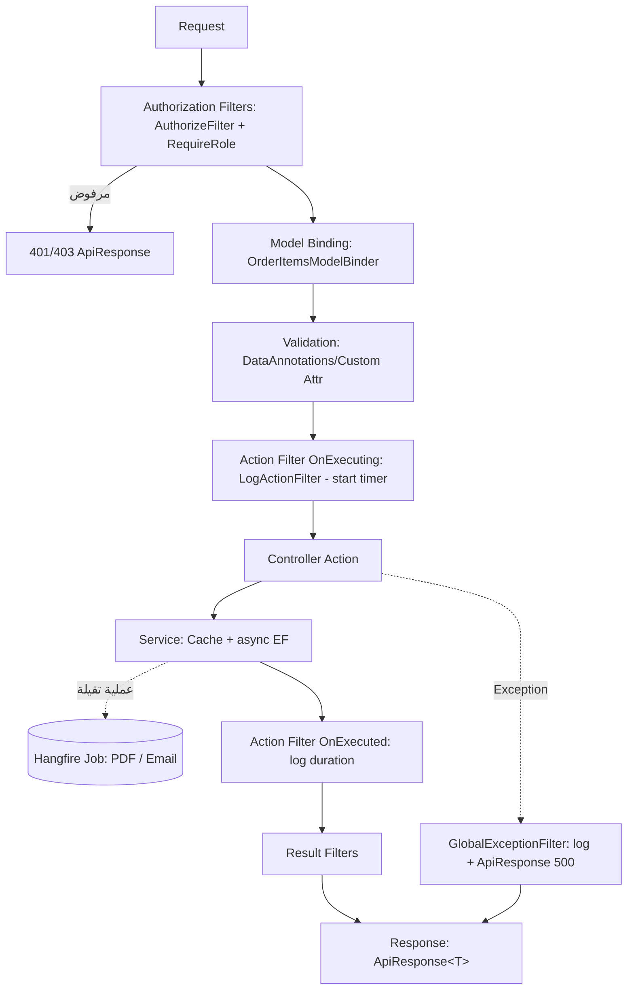

# Admin Dashboard System (ASP.NET Core MVC · .NET 8)

لوحة تحكم إدارية: Users · Products · Orders · Reports — بـ Filters, Custom Model Binder, AJAX Architecture, Async, Caching, Background Jobs.

## التشغيل
```bash
dotnet restore && dotnet run
```
- Admin: `admin@demo.com / Admin@123` · Sales: `sales@demo.com / Sales@123`
- أول تشغيل بيعمل Seed لـ 100,000 منتج (SQLite). غيّره من `Seed:Products`.
- Hangfire Dashboard: `/jobs` (Admin فقط)

## الـ Architecture
```
Controllers (رفيعة)  →  Services (Business + Cache + Async)  →  EF Core / SQLite
        ↑ Filters                       ↓ Hangfire Jobs (Email, PDF)
```
| الطبقة | المكان |
|---|---|
| Filters | `Filters/` |
| Custom Validation Attributes | `Validation/` |
| Model Binder | `ModelBinders/OrderItemsModelBinder.cs` |
| FluentValidation | `Validators/` |
| Services + Cache + Session Cart | `Services/` |
| Background Jobs | `Jobs/` |
| ApiResponse<T> | `Common/` |
| JS: ApiClient + ui (DataTable, Debounce) | `wwwroot/js/` |

## الـ Filters
1. **AuthorizeFilter (global)** — كل Action محمي.
2. **RequireRoleAttribute** — Authorization بالـ Role، يرجّع JSON 403 للـ API.
3. **LogActionFilter (global)** — Logging + Timing، وبيحذّر لو الـ Action أخد > 2 ثانية. مفيش Logging في أي Controller.
4. **GlobalExceptionFilter** — يلوج الخطأ ويرجّع `ApiResponse` موحّد (500) للـ `/api`.

## قرار الـ Validation
- Custom Attributes (`UniqueEmail`, `UniqueProductName`) للـ DTOs اللي بتجي من JSON body وبتتحقق من الـ DB بشكل Sync.
- FluentValidation (فيه `MustAsync`) للـ Products/Orders. بنناديه يدوياً لأن auto-validation مش بيدعم Async rules.

## Request Lifecycle


## Caching & Session
- `IMemoryCache`: Categories (30 دقيقة)، Countries (24 ساعة)، Dashboard summary (دقيقة).
- Session: الـ Cart في `CartService` ← `POST /api/orders/checkout`.

## Order Binder
`POST /api/orders` form-urlencoded: `items=id:1,qty:2|id:3,qty:5`

## Hangfire Jobs
- `EmailJobs.SendWelcomeEmailAsync` بعد إنشاء مستخدم.
- `ReportJobs.GenerateSalesReportAndEmailAsync` (QuestPDF) بعد `POST /api/reports/sales-pdf`.
- Storage حالياً In-Memory؛ غيّره لـ SQL Server/Redis في الإنتاج.
